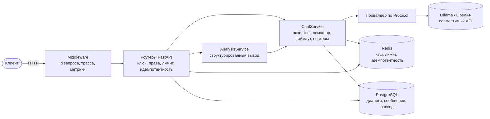
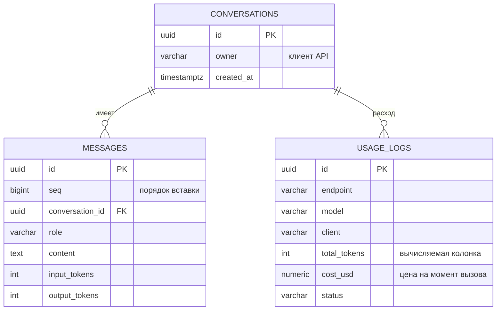

# llm-chat-api

[](https://github.com/DelixeamI/llm-chat-api/actions/workflows/ci.yml)

Асинхронный бэкенд для работы с LLM на FastAPI. Он делает вызов модели предсказуемым: ограничивает
время, повторяет только временные сбои, держит ответ в заданной схеме, считает токены и деньги,
не даёт отправить модели запрос длиннее её окна, защищает доступ ключом и лимитом, отвечает
одинаково на повтор запроса и показывает, что с ним происходит: логи, метрики, трассы.

Проект учебный: цель — освоить навыки Middle AI/LLM Engineer и уметь объяснить каждое решение.
Реальных пользователей и нагрузки у него нет, и цифры ниже — замеры на одной машине, а не обещания.
Код писался вместе с ИИ-ассистентом по 42-дневному роадмапу; каждое решение проверено замером или
тестом и описано в [docs/](docs/).

## Что умеет

| Область | Что сделано |
|---|---|
| **Чат** | `POST /v1/chat` с историей в PostgreSQL, потоковый ответ (SSE) с TTFT, классификация обращений по схеме |
| **Надёжность вызова** | таймаут на попытку, повторы только временных сбоев (экспоненциальная пауза, jitter), семафор на число вызовов, проверка контекстного окна до вызова |
| **Структурированный вывод** | JSON Schema из Pydantic → валидация → восстановление с показом модели её ошибки; обрыв по лимиту токенов не повторяется |
| **Деньги** | журнал расхода по каждому вызову, стоимость в `Decimal` на момент вызова, отчёты в USD и RUB, прогноз на месяц |
| **Redis** | кэш ответов (`temperature 0`, приватный по клиенту), лимит запросов (скользящее окно, один Lua-скрипт), идемпотентность (`Idempotency-Key`) |
| **Доступ** | API-ключи с правами `chat` и `admin`, 401 и 403, владелец диалога, чужой диалог — 404 |
| **Наблюдаемость** | JSON-логи с id запроса, метрики Prometheus, трассы OpenTelemetry, `/health` и `/ready` |
| **Запуск** | Docker Compose (приложение, миграции, PostgreSQL, Redis), CI на GitHub Actions |

## Быстрый старт

Нужны Docker и Python 3.12+ (Python — только чтобы создать `.env`).

```bash
git clone https://github.com/DelixeamI/llm-chat-api.git
cd llm-chat-api
python scripts/make_env.py --fake-llm       # создаёт .env и ключ API; ключ выводится один раз
docker compose --profile fake-llm up --build
```

Поднимутся PostgreSQL, Redis, миграции, приложение и **заглушка модели** (OpenAI-совместимая, без GPU).
Когда в логе появится `Application startup complete`, документация API открыта на
<http://127.0.0.1:8000/docs>: кнопка **Authorize** принимает ключ из вывода `make_env.py`.

Запрос из командной строки:

```bash
curl -X POST http://127.0.0.1:8000/v1/chat \
  -H "X-API-Key: <ваш ключ>" -H "Content-Type: application/json" \
  -d '{"model": "fake", "messages": [{"role": "user", "content": "Привет"}], "params": {"temperature": 0}}'
```

Ответ (повторите запрос: `cached` станет `true`, а модель не будет вызвана):

```json
{
  "conversation_id": "9d69db36-965a-427b-ae53-ccd9e7b02cfc",
  "model": "fake",
  "message": {"role": "assistant", "content": "echo: Привет"},
  "usage": {"input_tokens": 1, "output_tokens": 2, "total_tokens": 3},
  "dropped_messages": 0,
  "cached": false
}
```

### С настоящей моделью

Нужна [Ollama](https://ollama.com) на хосте:

```bash
ollama pull qwen3:8b
python scripts/make_env.py
docker compose up --build
```

Контейнер обращается к Ollama по `host.docker.internal:11434`. Если она слушает только `127.0.0.1` и
контейнер её не видит, запустите её с `OLLAMA_HOST=0.0.0.0`. Подробности — в
[docs/docker.md](docs/docker.md).

### Проверить стек целиком

```bash
pip install -r requirements-dev.lock
API_KEY=<ключ> MODEL=fake python -m scripts.smoke_stack
```

Пятнадцать проверок: готовность, 401 без ключа, чат и запись в PostgreSQL, кэш Redis, повтор с
`Idempotency-Key`, поток, структурный ответ, 502 при сбое модели, расход, метрики. Тот же скрипт
выполняется в CI.

### Разработка на хосте

```bash
python -m venv .venv && .venv\Scripts\activate          # Linux/macOS: source .venv/bin/activate
pip install -r requirements-dev.lock
python scripts/make_env.py
docker compose up -d postgres redis                      # только зависимости
alembic upgrade head
uvicorn app.main:app --reload
```

## Архитектура



- **Роутер** отвечает за HTTP: схемы, зависимости, коды. Бизнес-логики в нём нет.
- **Сервис** управляет надёжностью вызова и не знает ни про HTTP, ни про SDK вендора.
- **Провайдер** вызывает конкретную модель и переводит её ошибки в собственные исключения.
- **PostgreSQL** — источник истины. **Redis** хранит только то, что можно потерять.

Полный путь запроса от HTTP до записи в базу: [docs/request-lifecycle.md](docs/request-lifecycle.md).
Три главных компромисса и отвергнутые альтернативы: [docs/trade-offs.md](docs/trade-offs.md).

## Схема базы данных



Подробно, с индексами и миграциями: [docs/database.md](docs/database.md).

## API

| Метод | Путь | Право | Назначение |
|---|---|---|---|
| `GET` | `/health` | — | процесс жив (ничего вне процесса не проверяет) |
| `GET` | `/ready` | — | можно ли слать трафик: PostgreSQL и Redis |
| `POST` | `/v1/chat` | `chat` | ответ модели; `Idempotency-Key` защищает повтор |
| `POST` | `/v1/chat/stream` | `chat` | то же потоком Server-Sent Events |
| `POST` | `/v1/chat/structured` | `chat` | классификация обращения строго по схеме |
| `POST` / `GET` | `/v1/conversations…` | `chat` | создать диалог, прочитать диалог и историю |
| `GET` | `/v1/usage`, `/v1/usage/cost` | `admin` | расход токенов; стоимость в USD и RUB, прогноз на месяц |
| `GET` | `/v1/cache/stats` | `admin` | попадания и промахи кэша |
| `GET` | `/metrics` | `admin` | метрики Prometheus (ключ в `X-API-Key` или Bearer) |

| Код | Когда |
|---|---|
| `200` / `201` | успех |
| `400` | запрос не помещается в контекстное окно; ключ идемпотентности у потока |
| `401` / `403` | нет или неверный ключ / нет нужного права |
| `404` | диалог не найден **или принадлежит другому клиенту** |
| `409` / `422` | запрос с этим `Idempotency-Key` ещё идёт / тот же ключ с другим телом; ошибка валидации |
| `429` | лимит запросов клиента; `Retry-After` в заголовке |
| `502` / `504` | сбой или молчание модели, ответ модели не прошёл проверку |
| `503` | база данных недоступна; Redis недоступен там, где без него нельзя |

Все ответы несут `X-Request-ID`. Ошибки — в едином формате `{"error": "...", "detail": "..."}`.

## Как это устроено

- **Структурированный вывод.** Просьба «верни JSON» дала 0 годных ответов из 12, JSON mode — 1, схема
  провайдера — 12. Но грамматика не держит диапазоны (`confidence: 150` прошёл), поэтому ответ
  проверяется в приложении, а при ошибке модель получает своё нарушение и пробует ещё раз.
  [docs/structured-output.md](docs/structured-output.md)
- **Асинхронность.** Весь ввод-вывод асинхронный; семафор ограничивает вызовы модели, таймаут
  отсчитывается после получения слота. С Ollama async почти не ускоряет (1.04x): она отвечает
  по одному запросу; имитация сети дала 4.93x. [docs/async-experiments.md](docs/async-experiments.md)
- **Ошибки и отказы.** Ошибки вендора переводятся в свои; повторяются только временные сбои; каждая
  Redis-возможность при отказе деградирует по-своему, а не ломает запрос; сбои, воспроизведённые
  намеренно, перечислены с тестами в [docs/failure-scenarios.md](docs/failure-scenarios.md).
- **Токены и стоимость.** Расход пишется в журнал по каждому вызову, включая неудачные, цена
  фиксируется в момент вызова; Ollama молча обрезает слишком длинный промпт, поэтому окно
  проверяется до вызова. [docs/usage-and-cost.md](docs/usage-and-cost.md),
  [docs/context-window.md](docs/context-window.md)
- **Кэш, лимит, идемпотентность.** [docs/caching.md](docs/caching.md),
  [docs/rate-limiting.md](docs/rate-limiting.md), [docs/idempotency.md](docs/idempotency.md),
  [docs/redis.md](docs/redis.md)
- **Доступ.** [docs/auth.md](docs/auth.md)
- **Стриминг.** [docs/streaming.md](docs/streaming.md)
- **Наблюдаемость.** [docs/logging.md](docs/logging.md), [docs/metrics.md](docs/metrics.md),
  [docs/tracing.md](docs/tracing.md), [docs/health.md](docs/health.md)
- **Контейнеры и CI.** [docs/docker.md](docs/docker.md), [docs/ci.md](docs/ci.md)

## Настройки

Все переменные перечислены с пояснениями в [.env.example](.env.example). Основные:

| Переменная | По умолчанию | Назначение |
|---|---|---|
| `API_KEYS` | пусто: всё закрыто | JSON-список `{client, key, scopes}`; создаёт `make_env.py` |
| `OLLAMA_BASE_URL` | `http://127.0.0.1:11434/v1` | OpenAI-совместимый API модели |
| `LLM_TIMEOUT_SECONDS`, `LLM_MAX_RETRIES`, `LLM_MAX_CONCURRENCY` | `60`, `2`, `5` | таймаут попытки, повторы, вызовов одновременно |
| `CONTEXT_OVERFLOW_STRATEGY` | `reject` | `reject` или `truncate_oldest` |
| `DATABASE_URL`, `REDIS_URL` | локальные | подключение к PostgreSQL и Redis |
| `RATE_LIMIT_REQUESTS`, `RATE_LIMIT_WINDOW_SECONDS` | `20`, `60` | лимит запросов на клиента |
| `RESPONSE_CACHE_TTL_SECONDS` | `3600` | срок жизни кэша |
| `LOG_LEVEL`, `LOG_FORMAT` | `INFO`, `json` | логи |
| `TRACING_ENABLED`, `TRACING_OTLP_ENDPOINT` | `false` | трассировка OpenTelemetry |
| `READY_REDIS_REQUIRED` | `false` | считать недоступный Redis причиной «не готов» |

## Проверки

```bash
pytest                                   # 25 интеграционных тестов без PostgreSQL и Redis пропускаются
pytest --cov=app                         # покрытие с ветвлениями, в CI порог 90%
ruff check . && ruff format --check .    # линтер и форматирование
mypy app tests scripts tools migrations  # строгая типизация
```

CI (GitHub Actions) выполняет всё это на настоящих PostgreSQL и Redis, собирает образ и проверяет весь
стек дымовым тестом; интеграционные тесты в нём не могут быть тихо пропущены. Покрытие в CI —
96%; покрытие говорит, какие строки выполнялись, а не что они проверены правильно.

## Структура проекта

```
app/
├── main.py            сборка, lifespan, обработчики ошибок
├── auth.py            ключи, права, сравнение за постоянное время
├── config.py          настройки из окружения
├── api/               роутеры, зависимости, безопасность
├── services/          chat, analysis, cache, ratelimit, idempotency, readiness, usage…
├── llm/               протокол провайдера, Ollama, структурированный вывод
├── db/                модели, репозиторий, сессии
├── kv/                клиент Redis, ключи, пауза после сбоя
├── observability/     логи, метрики, трассировка, middleware
└── schemas/           контракты Pydantic
migrations/            7 миграций Alembic
tests/                 тесты; фейки в fakes.py
scripts/               эксперименты, make_env, smoke_stack
tools/                 заглушка модели
docs/                  разбор решений и замеры
```

## Известные ограничения

Честный список; почти по каждому пункту есть причина в документах выше.

- **Это не production-система.** Нагрузочных тестов не было, пропускная способность не измерялась;
  Ollama с `OLLAMA_NUM_PARALLEL=1` обрабатывает запросы по одному.
- **Нет общего дедлайна запроса:** худший случай больше трёх минут (3 попытки по 60 с и паузы), для
  структурного ответа с восстановлением — вдвое больше. Ожидание слота семафора не ограничено.
- **Строка расхода пишется в одной транзакции с сообщениями:** если запись упала после ответа
  модели, потраченные токены нигде не учтены.
- **Лимиты на процесс:** семафор и пауза после сбоя Redis живут в памяти процесса; при нескольких
  воркерах лимит конкурентности умножается. Метрики тоже на процесс.
- **Оценка токенов — эвристика** (2.5 символа на токен): иногда отклоняет запрос, который
  поместился бы.
- **Кэш:** одновременные одинаковые промахи вызывают модель дважды; обновление весов под тем же
  именем модели ключ не видит, устаревание ограничивает только TTL.
- **Идемпотентность:** если ключ истёк посреди долгого запроса, повтор выполнится второй раз; поток
  ключ не принимает.
- **Ключи API** лежат в переменной окружения, а не в хранилище секретов; нет срока действия и отзыва
  без перезапуска.
- **Размер запроса не ограничен** по числу сообщений.
- **Нет CD:** образ собирается и проверяется, но не публикуется и не выкатывается.
- **Трассировка** размечена вручную; отправка на настоящий коллектор (Jaeger) не проверялась.
- **Цены условные:** локальная модель не выставляет счёт, учёт стоимости демонстрирует механику.
- **Нет RAG, агентов, tool calling и фреймворков (LangChain, LangGraph):** это отдельные проекты.

## Идеи для развития

По важности: общий дедлайн запроса и таймаут ожидания слота (503); запись расхода отдельной
транзакцией; ограничение размера запроса; блокировка на ключ при одновременных промахах кэша;
токенайзер модели вместо оценки; лимит по токенам и стоимости; мультипроцессные метрики; хранилище
секретов и отзыв ключей; публикация образа и выкатка (CD); автоинструментирование SQL и Redis в
трассах; дашборды и алерты на метрики; оценка качества классификации на размеченном наборе.

## Роадмап

| Неделя | Тема | Статус |
|---|---|---|
| 1 | FastAPI, Pydantic, слоистая архитектура | ✅ |
| 2 | Интеграция LLM и asyncio: таймауты, повторы, ограничение конкурентности | ✅ |
| 3 | PostgreSQL, миграции, транзакции | ✅ |
| 4 | Structured output, учёт токенов и стоимости, контекстное окно | ✅ |
| 5 | Redis, кэш, стриминг, авторизация, rate limiting, идемпотентность | ✅ |
| 6 | Логи, метрики, трассировка, готовность, Docker, CI, релиз v1.0 | ✅ |
