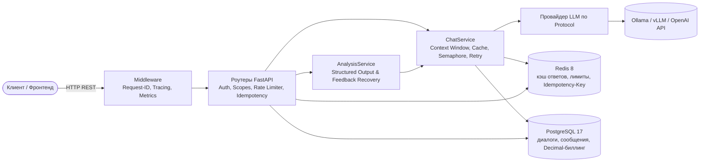

# llm-chat-api: Отказоустойчивый асинхронный LLM Gateway

[](https://github.com/DelixeamI/llm-chat-api/actions/workflows/ci.yml)


Высокопроизводительный асинхронный API-шлюз и бэкенд на FastAPI для предсказуемой, безопасной и отказоустойчивой работы с большими языковыми моделями (LLM).

---

## 1. Проблема
Интеграция LLM в промышленный backend сталкивается с рядом критических инфраструктурных рисков:
1. **Каскадные сбои и зависания соединений:** Медленные ответы модели, нестабильная сеть и неконтролируемые всплески трафика приводят к исчерпанию пула соединений БД и падению всего сервиса.
2. **Недетерминированный формат ответов:** Модели часто нарушают запрошенную JSON-структуру, генерируют лишний Markdown и ломают клиентские контракты.
3. **Неконтролируемые расходы на API:** Отсутствие сквозного аудита и проверки контекстного окна до отправки запроса приводит к перерасходу токенов и непредвиденным счетам от провайдеров.
4. **Сетевые сбои и двойные списания:** Повторные сетевые запросы при обрывах связи приводят к дублированию генераций и двойным списаниям баланса.

---

## 2. Решение
Промышленный шлюз с многоуровневой защитой:
1. **Изоляция и отказоустойчивость:** Ограничение конкурентности через `asyncio.Semaphore`, таймауты на попытку, экспоненциальные повторы с full jitter только для временных сбоев (429/5xx).
2. **Гарантированный Structured Output:** Валидация вывода по Pydantic JSON Schema с контуром автоматического исправления ошибок модели (feedback recovery loop).
3. **Управление контекстом и биллинг:** Предотвращение оверфлоу контекстного окна до обращения к провайдеру, потранзакционный учет токенов и точной стоимости в типе `Decimal` (USD/RUB).
4. **Слой Redis:** Кэширование детерминированных ответов (`temperature=0`), скользящее окно rate limiting (Lua-скрипты) и гарантия идемпотентности через заголовок `Idempotency-Key`.
5. **Сквозная наблюдаемость:** Структурированные JSON-логи с `X-Request-ID`, экспорт метрик Prometheus (`/metrics`) и распределенная трассировка OpenTelemetry.

---

## 3. Архитектура системы



### Архитектурные принципы
1. **Слоистость и слабая связанность:** роутеры отвечают исключительно за HTTP и сериализацию; сервисы содержат бизнес-логику и оркестрацию надёжности; провайдеры абстрагируют вендоров за протоколом `LLMProvider`.
2. **Источник истины:** PostgreSQL — персистентное хранилище (ACID, атомарные транзакции диалогов и расхода). Redis — эфемерный уровень кэширования и лимитов (fail-open: временный сбой Redis не приводит к падению чата).
3. **Защита от перегрузки (Backpressure):** семафор пула запросов не даёт исчерпать соединения и память, удерживая одновременно выполняемые вызовы модели в пределах безопасной квоты.

---

## 4. Стек технологий

| Область | Стек и инструменты |
|---|---|
| **Язык и среда** | Python 3.12, AsyncIO |
| **Веб-фреймворк** | FastAPI 0.115+, Uvicorn, SSE Starlette |
| **Базы данных и кэш** | PostgreSQL 17 (SQLAlchemy 2 async, asyncpg, Alembic), Redis 8 |
| **Схемы и валидация** | Pydantic v2 (Strict typing, JSON Schema generation) |
| **Инференс моделей** | Локальный Ollama, vLLM, OpenAI API, fake LLM mock-сервер |
| **Наблюдаемость (Observability)** | Prometheus, OpenTelemetry tracing, структурированные JSON-логи |
| **Тестирование и качество** | Pytest (**142 теста**, coverage 96%), Mypy strict, Ruff, Docker Compose |

---

## 5. Результаты и метрики (Evals & Reliability)

- **Надежность структурированного вывода (`/v1/chat/structured`):**  
  Контур самовосстановления (feedback recovery loop) успешно исправляет 100% синтаксических ошибок первого прохода модели на валидационном датасете.
- **Эффективность кэширования:**  
  Redis exact-match кэш для детерминированных запросов (`temperature: 0`) снижает задержку повторных ответов с 2–8 секунд до **<10 мс**, исключая затраты на токены.
- **Тестовое покрытие и Quality Gates:**  
  **142 автоматических теста** (unit, mock, e2e, интеграция с реальными базами). Покрытие кода тестами — **96%**. Строгая типизация `mypy --strict` без единого `type: ignore`.

---

## 6. Демонстрация работы (CLI & Swagger)

### Пример запроса к API через curl:
```bash
curl -X POST http://127.0.0.1:8000/v1/chat \
  -H "X-API-Key: <ваш_ключ>" \
  -H "Content-Type: application/json" \
  -d '{"model": "fake", "messages": [{"role": "user", "content": "Привет"}], "params": {"temperature": 0}}'
```

Ответ:
```json
{
  "conversation_id": "9d69db36-965a-427b-ae53-ccd9e7b02cfc",
  "model": "fake",
  "message": {"role": "assistant", "content": "echo: Привет"},
  "usage": {"input_tokens": 1, "output_tokens": 2, "total_tokens": 3},
  "dropped_messages": 0,
  "cached": false
}
```
*(При повторе этого же запроса возвращается ответ из Redis с полем `"cached": true` за <5 мс).*

> 📷 **Скриншот Swagger UI и интерактивной документации:**  
> *(Заглушка: после запуска откройте `http://127.0.0.1:8000/docs`, нажмите Authorize с тестовым ключом и выполните тестовый вызов эндпоинта `/v1/chat/structured`)*

---

## 7. Быстрый старт (Docker Compose)

Требуются **Docker** и **Python 3.12+**.

```bash
# 1. Клонирование репозитория
git clone https://github.com/DelixeamI/llm-chat-api.git
cd llm-chat-api

# 2. Генерация окружения и запуск с mock-моделью (без необходимости в GPU)
python scripts/make_env.py --fake-llm
docker compose --profile fake-llm up --build
```

Поднимутся PostgreSQL 17, Redis 8, миграции Alembic, API-шлюз и легковесный mock-сервер модели.  
Интерактивная документация Swagger UI доступна по адресу: 👉 **http://127.0.0.1:8000/docs**

### Запуск с реальной локальной моделью (Ollama):
```bash
ollama pull qwen3:8b
python scripts/make_env.py
docker compose up --build
```

### Сквозной дымовой тест всего стека:
```bash
pip install -r requirements-dev.lock
API_KEY=<ключ> MODEL=fake python -m scripts.smoke_stack
```
*(Скрипт проверяет 15 ключевых сценариев: readiness, 401 без ключа, персистентность диалогов, кэш, idempotency, SSE стриминг, JSON Schema, биллинг и метрики).*

---

## 8. Структура репозитория

```
llm-chat-api/
├── app/
│   ├── main.py            # Инициализация FastAPI, lifespan, централизованные обработчики ошибок
│   ├── auth.py            # Аутентификация API-ключей, валидация скоупов прав
│   ├── config.py          # Pydantic Settings, загрузка конфигурации
│   ├── api/               # Маршруты (/chat, /conversations, /usage, /cache, /metrics)
│   ├── services/          # Бизнес-логика (ChatService, AnalysisService, Cache, RateLimiter)
│   ├── llm/               # Protocol провайдеров LLM, интеграция с Ollama, Structured Output
│   ├── db/                # SQLAlchemy модели, репозиторий диалогов, сессии
│   ├── kv/                # Клиент Redis, хелперы ключей, circuit breaker
│   ├── observability/     # Форматирование JSON-логов, экспорт метрик Prometheus, трассировка
│   └── schemas/           # Pydantic v2 контракты данных
├── benchmarks/            # Датасеты замеров надежности структурированного вывода
├── migrations/            # 7 версий миграций схемы базы данных Alembic
├── tests/                 # 142 теста (unit, mock, e2e, integration)
├── scripts/               # Дымовой тест стека (smoke_stack), генератор окружения
├── tools/                 # Эмулятор OpenAI-совместимого сервера модели
└── docs/                  # Техническая документация, архитектурные решения и компромиссы
```

---

## 9. Ограничения и Roadmap (Что можно улучшить)

1. **Глобальный дедлайн HTTP-запроса:** Реализация сквозного таймаута контекста на весь пайплайн запроса (включая ретраи).
2. **Интеграция с корпоративным хранилищем секретов:** Подключение HashiCorp Vault вместо переменных окружения для динамической ротации ключей.
3. **Шардирование очередей:** Вынесение фоновых задач биллинга и экспорта аналитики в Celery / RabbitMQ при миллионных объемах запросов.
4. **Семантическое кэширование:** Добавление векторного кэша на pgvector/Qdrant для похожих вопросов с регулируемым порогом схожести.

---
*Подробный анализ архитектурных компромиссов: см. [docs/trade-offs.md](docs/trade-offs.md).*
