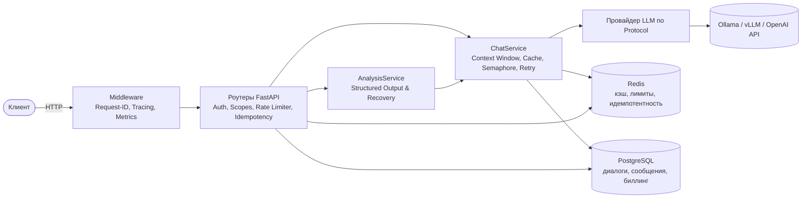
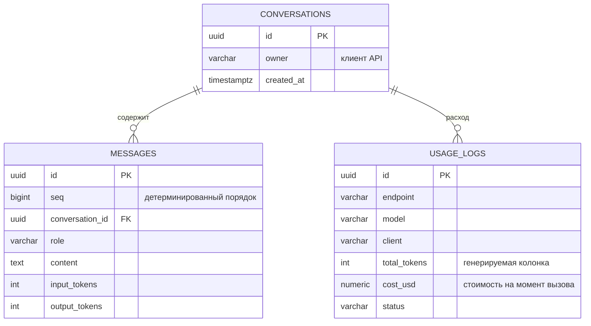

# llm-chat-api

[](https://github.com/DelixeamI/llm-chat-api/actions/workflows/ci.yml)


Высокопроизводительный асинхронный API-шлюз и бэкенд на FastAPI для предсказуемой и надёжной работы с большими языковыми моделями (LLM).

Сервис решает ключевые инфраструктурные проблемы интеграции нейросетей в production-контуре:
- защищает от зависаний и каскадных сбоев через таймауты, экспоненциальные повторы с джиттером и ограничение конкурентности семафором;
- гарантирует структурированный ответ строго по схеме (JSON Schema из Pydantic) с контуром автоматического восстановления при ошибках модели;
- предотвращает оверфлоу контекстного окна до отправки запроса вендору;
- ведёт потранзакционный учёт токенов и точной стоимости запросов (`Decimal`) в USD и RUB с прогнозом расходов;
- защищает эндпоинты API-ключами с разделением скоупов (`chat`/`admin`) и изоляцией диалогов клиентов;
- кэширует детерминированные ответы (`temperature: 0`) и ограничивает частоту запросов (скользящее окно Redis на Lua);
- гарантирует идемпотентность через `Idempotency-Key`, исключая повторные списания и генерации при сбоях сети;
- обеспечивает сквозную наблюдаемость: структурированные JSON-логи с `X-Request-ID`, метрики Prometheus и трассировка OpenTelemetry.

---

## Возможности сервиса

| Область | Реализация |
|---|---|
| **Чат и стриминг** | `POST /v1/chat` с историей в PostgreSQL; потоковый ответ `POST /v1/chat/stream` (Server-Sent Events) с измерением TTFT (Time-To-First-Token) |
| **Надёжность вызова** | Таймаут на попытку, повторы только временных сбоев (экспоненциальная пауза + jitter), семафор на число одновременных вызовов модели |
| **Структурированный вывод** | Генерация JSON Schema из Pydantic v2 → валидация ответа → контур самовосстановления при ошибке; обрыв по лимиту токенов не повторяется |
| **Биллинг и контекст** | Проверка контекстного окна до вызова модели, журнал расхода по каждому обращению, фиксация стоимости в `Decimal`, отчёты в USD и RUB, прогноз на месяц |
| **Слой Redis** | Кэш ответов (`temperature: 0`, изолирован по клиентам), Rate Limiting (скользящее окно на Lua), идемпотентность через заголовок `Idempotency-Key` |
| **Безопасность и доступ** | Аутентификация по `X-API-Key`, роли `chat` и `admin`, проверка владельца диалога (доступ к чужому диалогу возвращает `404`) |
| **Наблюдаемость (Observability)** | Структурированные JSON-логи с id запроса, метрики Prometheus (`/metrics`), распределённая трассировка OpenTelemetry, проверки `/health` и `/ready` |
| **Инфраструктура и CI** | Multi-stage Dockerfile, Docker Compose со всеми зависимостями и mock-моделью, строгий CI-пайплайн на GitHub Actions (Ruff, Mypy strict, тесты с реальными PostgreSQL 17 и Redis 8) |

---

## Быстрый старт

Требуются **Docker** и **Python 3.12+** (Python нужен для локальной генерации ключей и `.env`).

```bash
git clone https://github.com/DelixeamI/llm-chat-api.git
cd llm-chat-api
python scripts/make_env.py --fake-llm       # генерирует .env и выводит одноразовый API-ключ
docker compose --profile fake-llm up --build
```

Поднимутся PostgreSQL 17, Redis 8, контейнер с миграциями Alembic, сам API-шлюз и **заглушка модели** (быстрый OpenAI-совместимый эмулятор без необходимости в GPU).

После сообщения `Application startup complete` документация Swagger UI доступна по адресу:  
👉 **http://127.0.0.1:8000/docs** (кнопка **Authorize** принимает сгенерированный API-ключ).

### Пример запроса через curl

```bash
curl -X POST http://127.0.0.1:8000/v1/chat \
  -H "X-API-Key: <ваш_ключ>" \
  -H "Content-Type: application/json" \
  -d '{"model": "fake", "messages": [{"role": "user", "content": "Привет"}], "params": {"temperature": 0}}'
```

Ответ:

```json
{
  "conversation_id": "9d69db36-965a-427b-ae53-ccd9e7b02cfc",
  "model": "fake",
  "message": {"role": "assistant", "content": "echo: Привет"},
  "usage": {"input_tokens": 1, "output_tokens": 2, "total_tokens": 3},
  "dropped_messages": 0,
  "cached": false
}
```
*(При повторе этого же запроса вернётся ответ из Redis с полем `"cached": true` без обращения к модели).*

### Запуск с реальной локальной моделью (Ollama)

Установите и запустите [Ollama](https://ollama.com):

```bash
ollama pull qwen3:8b
python scripts/make_env.py
docker compose up --build
```
*(Подробности сетевого взаимодействия между Docker и хостом описаны в [docs/docker.md](docs/docker.md)).*

### Сквозной дымовой тест всего стека

```bash
pip install -r requirements-dev.lock
API_KEY=<ключ> MODEL=fake python -m scripts.smoke_stack
```
Скрипт выполняет 15 проверок сервиса: readiness-пробы, отказ 401 без ключа, чат и персистентность в PostgreSQL, кэширование Redis, повтор с `Idempotency-Key`, потоковый ответ (SSE), классификацию по JSON Schema, изоляцию клиентов, биллинг и метрики.

---

## Архитектура системы



### Архитектурные принципы
1. **Слоистость и слабая связанность:** роутеры отвечают исключительно за HTTP и сериализацию; сервисы содержат бизнес-логику и оркестрацию надёжности; провайдеры абстрагируют SDK конкретных вендоров за протоколом.
2. **Источник истины:** PostgreSQL — персистентное хранилище (ACID, атомарные транзакции диалогов и расхода). Redis — эфемерный уровень кэширования и лимитов (fail-open: временный сбой Redis не приводит к падению чата).
3. **Защита от перегрузки (Backpressure):** семафор пула запросов не даёт исчерпать соединения и память, удерживая одновременно выполняемые вызовы модели в пределах квоты.

Подробное описание: [docs/architecture.md](docs/architecture.md)  
Жизненный цикл запроса: [docs/request-lifecycle.md](docs/request-lifecycle.md)  
Обоснование ключевых компромиссов: [docs/trade-offs.md](docs/trade-offs.md)

---

## Схема базы данных


Подробное описание схемы, индексов и миграций: [docs/database.md](docs/database.md).

---

## API спецификация

| Метод | Эндпоинт | Права | Назначение |
|---|---|---|---|
| `GET` | `/health` | — | Liveness-проба (проверка жизнеспособности процесса) |
| `GET` | `/ready` | — | Readiness-проба (проверка доступности PostgreSQL и Redis) |
| `POST` | `/v1/chat` | `chat` | Синхронная генерация ответа модели; поддержка `Idempotency-Key` |
| `POST` | `/v1/chat/stream` | `chat` | Потоковая генерация ответа через Server-Sent Events (SSE) |
| `POST` | `/v1/chat/structured` | `chat` | Классификация обращения строго по Pydantic JSON Schema |
| `POST` | `/v1/conversations` | `chat` | Создать диалог с привязкой к клиенту-владельцу |
| `GET` | `/v1/conversations/{id}` | `chat` | Получить метаданные диалога |
| `GET` | `/v1/conversations/{id}/messages` | `chat` | Получить упорядоченную историю сообщений диалога |
| `GET` | `/v1/usage` | `admin` | Агрегированный расход токенов по моделям |
| `GET` | `/v1/usage/cost` | `admin` | Расчёт затрат в USD/RUB и прогноз расходов на месяц |
| `GET` | `/v1/cache/stats` | `admin` | Статистика попаданий (hits) и промахов (misses) кэша |
| `GET` | `/metrics` | `admin` | Экспорт метрик в формате Prometheus |

### Коды ответов
- `200` / `201`: Успешная обработка.
- `400`: Запрос превышает контекстное окно модели / недопустимый заголовок идемпотентности.
- `401` / `403`: Отсутствует или недействителен API-ключ / недостаточно прав доступа.
- `404`: Диалог не найден **или принадлежит другому клиенту** (защита от сканирования ID).
- `409`: Запрос с переданным `Idempotency-Key` уже находится в процессе обработки.
- `422`: Ошибка валидации структуры входных данных (Pydantic).
- `429`: Превышен лимит запросов клиента (содержит заголовок `Retry-After`).
- `502`: Ошибка провайдера LLM или невалидный структурированный ответ после попытки исправления.
- `503`: База данных недоступна / критический сбой инфраструктуры.
- `504`: Превышен таймаут ответа модели (`LLM_TIMEOUT_SECONDS`).

Все ответы содержат заголовок `X-Request-ID` для сквозной трассировки.

---

## Детальный разбор подсистем

- **Структурированный вывод и самовосстановление:** Подробный сравнительный анализ подходов (prompt-only vs JSON mode vs JSON Schema) с замерами надёжности: [docs/structured-output.md](docs/structured-output.md).
- **Асинхронность и конкурентность:** Замеры влияния семафоров и connection pooling на задержку и пропускную способность: [docs/async-experiments.md](docs/async-experiments.md).
- **Сценарии сбоев и отказоустойчивость:** Каталог воспроизведённых сбоев (таймауты, падения Redis/БД, сбои модели) с покрывающими их тестами: [docs/failure-scenarios.md](docs/failure-scenarios.md).
- **Биллинг и контекстное окно:** Формулы расчёта стоимости, хранение в `Numeric`, алгоритмы обрезания истории сообщений: [docs/usage-and-cost.md](docs/usage-and-cost.md), [docs/context-window.md](docs/context-window.md).
- **Кэширование, лимиты, идемпотентность:** Архитектура взаимодействия с Redis: [docs/caching.md](docs/caching.md), [docs/rate-limiting.md](docs/rate-limiting.md), [docs/idempotency.md](docs/idempotency.md), [docs/redis.md](docs/redis.md).
- **Аутентификация и безопасность:** [docs/auth.md](docs/auth.md).
- **Потоковая передача данных (SSE):** [docs/streaming.md](docs/streaming.md).
- **Наблюдаемость (Observability):** [docs/logging.md](docs/logging.md), [docs/metrics.md](docs/metrics.md), [docs/tracing.md](docs/tracing.md), [docs/health.md](docs/health.md).
- **Контейнеризация и CI:** [docs/docker.md](docs/docker.md), [docs/ci.md](docs/ci.md).

---

## Локальная разработка и проверки качества

```bash
# Активация виртуального окружения и установка зависимостей
python -m venv .venv && .venv\Scripts\activate
pip install -r requirements-dev.lock

# Прогон тестового набора с расчётом покрытия
pytest --cov=app

# Линтинг и проверка форматирования кода
ruff check . && ruff format --check .

# Строгая статическая типизация
mypy app tests scripts tools migrations
```

### GitHub Actions CI
Пайплайн на каждый push и pull request запускает:
1. Линтинг (Ruff) и проверку соответствия lock-файлов `pyproject.toml`.
2. Строгую проверку типов (mypy strict).
3. Полный набор тестов против поднятых в контейнерах PostgreSQL 17 и Redis 8 с порогом ветвления покрытия не ниже 90%.
4. Сборку и валидацию Docker-образа с запуском сквозного дымового теста `smoke_stack.py` и проверкой корректности graceful shutdown (SIGTERM).

---

## Структура репозитория

```
app/
├── main.py            Инициализация FastAPI, lifespan, централизованные обработчики ошибок
├── auth.py            Аутентификация API-ключей, валидация скоупов прав
├── config.py          Pydantic Settings, загрузка переменных окружения
├── api/               Маршруты (эндпоинты), зависимости FastAPI, middleware
├── services/          Бизнес-логика (ChatService, AnalysisService, Cache, RateLimiter...)
├── llm/               Абстракция LLM-провайдера (Protocol), интеграция с Ollama, Structured Output
├── db/                SQLAlchemy модели, репозиторий диалогов, сессии
├── kv/                Клиент Redis, хелперы формирования ключей, circuit breaker
├── observability/     Форматирование логов, экспорт Prometheus-метрик, OpenTelemetry трассы
└── schemas/           Контракты данных (Pydantic v2)
benchmarks/            Датасеты замеров надёжности структурированного вывода
migrations/            7 версий миграций схемы базы данных Alembic
tests/                 Тестовый набор (unit, mock, e2e, integration)
scripts/               Вспомогательные утилиты, генератор .env, дымовой тест
tools/                 Эмулятор OpenAI-совместимого сервера модели (fake LLM server)
docs/                  Техническая документация, бенчмарки и архитектурные решения
```

---

## Архитектурные компромиссы и границы применимости

Честный анализ выбранных решений и их ограничений:

- **Локальный инференс:** При локальном тестировании с Ollama инференс ограничен `OLLAMA_NUM_PARALLEL=1` и обрабатывает запросы последовательно. Для промышленной эксплуатации шлюз переключается на внешний vLLM/TGI кластер или облачные API.
- **Дедлайн запроса:** В текущей версии отсутствует глобальный сквозной deadline на весь HTTP-запрос (худший случай с 3 повторами по 60 с может длиться до 3 минут).
- **Транзакционность биллинга:** Запись расхода токенов выполняется в одной транзакции с сохранением сообщения для соблюдения строгой атомарности диалога.
- **Хранение секретов:** API-ключи загружаются из переменных окружения. Для корпоративной среды рекомендуется интеграция с HashiCorp Vault или AWS Secrets Manager.
- **Оценка размера контекста:** До вызова модели размер промпта оценивается быстрой эвристикой (2.5 символа на токен), что исключает накладные расходы на вызов тяжелых токенайзеров на шлюзе.

Подробный разбор альтернатив и цены каждого инженерного решения приведён в [docs/trade-offs.md](docs/trade-offs.md).
