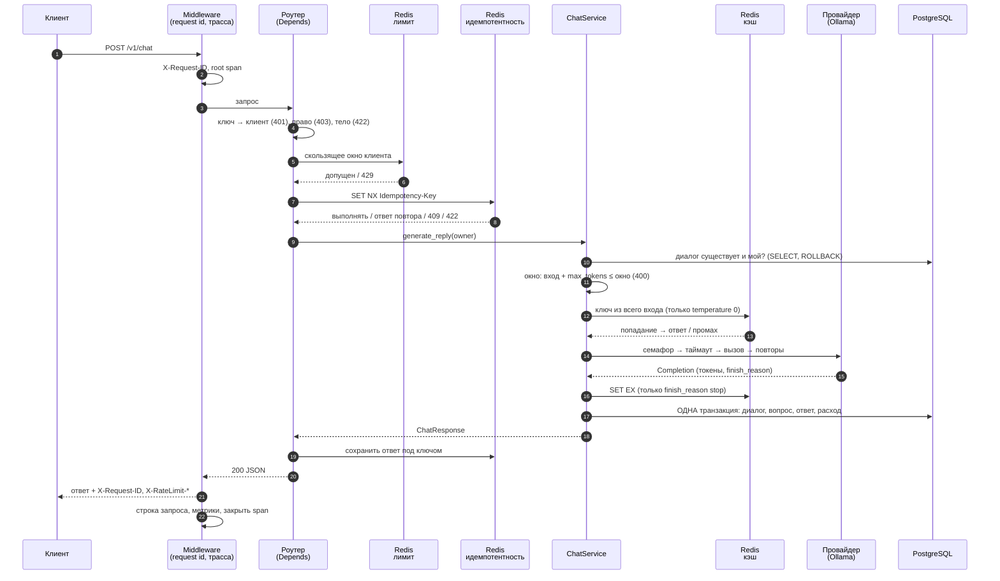

# Путь запроса от HTTP до сохранённого ответа

Один запрос `POST /v1/chat` от первого байта до записи в базу. Каждый шаг указывает, где он в коде,
чем отказывает и какой пользой оплачен.

## Шаг за шагом

| # | Шаг | Код | Отказ |
|---|---|---|---|
| 1 | Идентификатор запроса и корневой span; метка времени | `RequestContextMiddleware` | непредвиденное — 500 с id |
| 2 | Ключ API → клиент | `current_client` (`Depends`) | 401, одинаково для пропавшего и неверного |
| 3 | Право `chat` | `require_scope` | 403 |
| 4 | Разбор тела по `ChatRequest`: `extra="forbid"`, пределы, есть `user` | Pydantic | 422 |
| 5 | Лимит запросов клиента (Lua, скользящее окно) | `enforce_rate_limit` | 429 + `Retry-After`; Redis лёг — пропускает |
| 6 | `Idempotency-Key`: `SET NX` | `run_idempotent` | повтор: тот же ответ; идёт: 409; другое тело: 422; Redis лёг — без защиты |
| 7 | Диалог существует и принадлежит клиенту | `_require_conversation` | 404 и для чужого |
| 8 | Проверка окна | `ContextBudget.fit` | 400 `context_length_exceeded` |
| 9 | Поиск в кэше (`temperature 0`, ключ по клиенту) | `ResponseCache` | Redis лёг — промах |
| 10 | Вызов модели: семафор → таймаут → повторы | `ChatService.complete` | 502 / 504 |
| 11 | Запись обмена одной транзакцией | `_persist_exchange` | откат, 503 если база недоступна |
| 12 | Сохранение ответа под ключом идемпотентности | `IdempotencyStore.complete` | |
| 13 | Метрики, строка запроса, закрытие span | middleware | |

### Что стоит запомнить в порядке шагов

- **Дешёвое и безопасное — раньше.** Аутентификация и право проверяются до разбора тела (аноним не
  узнаёт формат), лимит — после аутентификации (чужие ключи не тратят лимит клиента), проверка
  диалога и окна — до вызова модели (отказ ничего не стоит).
- **Идемпотентность стоит после лимита:** повтор считается в лимит, иначе цикл повторов обходил бы
  его.
- **Вызов модели идёт без открытой транзакции.** Проверка диалога — `SELECT` и сразу `ROLLBACK`,
  запись — одна транзакция уже после ответа.
- **Расход пишется в той же транзакции, что и сообщения** (известный недостаток: если запись
  упала, токены не учтены).

## Три варианта пути

**Попадание в кэш.** Шаги 1–9 те же. Ответ находится на шаге 9, модель не вызывается (10 пропущен),
сообщения пишутся, строка расхода нет, ответ с `cached: true`. Время — единицы миллисекунд.

**Поток** (`/v1/chat/stream`). Те же шаги 1–9, ключ идемпотентности не принимается (400). Эндпоинт
дожидается **первого события** до начала ответа: пока оно не получено, любой сбой — обычная
HTTP-ошибка. Дальше идут `delta`, затем `done` с токенами, TTFT и временем; сбой после первого
куска — событие `error`. Запись в базу происходит после последнего куска. Отключение клиента
закрывает цепочку до потока к модели, обмен не сохраняется.

**Структурированный анализ** (`/v1/chat/structured`). Вместо шага 10 цикл: вызов с JSON Schema →
`json.loads` → `model_validate` → при ошибке повтор с показом модели её ответа и нарушенного
правила. Обрыв по `max_tokens` — сразу отказ. Токены всех попыток суммируются в одну строку
журнала расхода, в том числе при неудаче.

## Что остаётся после запроса

| Где | Что |
|---|---|
| PostgreSQL | диалог (владелец), вопрос, ответ с токенами, строка `usage_logs` с ценой на момент вызова |
| Redis | ответ в кэше (`llm-chat:cache:v1:…`, TTL час), ответ под ключом идемпотентности (TTL сутки), записи лимита (TTL окно) |
| Лог | строка запроса и строка вызова модели с одним `request_id` |
| Метрики | счётчики и гистограммы, без идентификаторов в метках |
| Трасса | дерево шагов, если трассировка включена |
